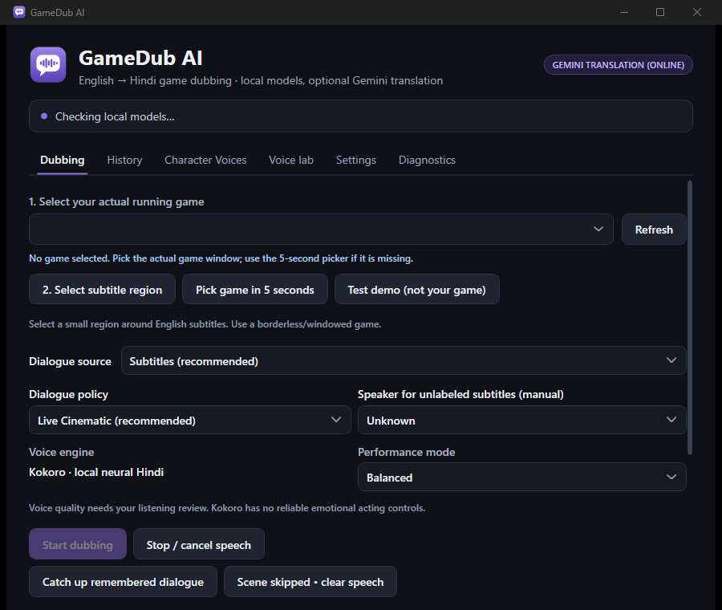

<div align="center">


# GameDub AI

**Play English games in Hindi.** GameDub AI reads a game's English subtitles, translates them to natural Hindi and speaks them with a local neural voice while you play.




</div>

---

## How it works

```
 READ            TRANSLATE             VOICE                 PLAY
 subtitle  ──▶  English → Hindi  ──▶  Hindi neural TTS  ──▶  your headphones,
 region OCR      (local MT / LLM,      (Kokoro, IndicF5)       over the game's
                  optional Gemini)                              music and effects
```

1. **Read:** you drag a box around the game's subtitles. GameDub crops only that region in memory and reads it with Windows English OCR. There's no screen recording, injection or game-file change.
2. **Translate:** each line is translated with a local model (Marian/OPUS-MT, or a local conversational LLM when GPU memory allows). Gemini is optional and needs your own key.
3. **Voice:** Kokoro (4 Hindi voices) or IndicF5 speaks the line. Characters can be mapped to voices.
4. **Play:** audio goes to the device you choose. Optional ducking lowers the game's mix while Hindi plays.

A live queue keeps the dub close to the scene. **Live Cinematic** drops lines that are too old; **Story Complete** speaks everything in order.

## Features

- Pick the game window and subtitle region, or use the 5-second picker
- Subtitles, game-audio ASR (experimental) or automatic source selection
- Character → voice mapping and per-game profiles (glossary, relationships)
- Voice lab: try any line, A/B voices, rate playback
- Dialogue history with replay of skipped lines
- Diagnostics: OCR timing, crop capture, resource monitor
- Fully offline by default; no accounts or telemetry

## Quick start

> Requires Windows 11 x64 and the Windows English OCR language pack.

**Run a release build**

1. Download `GameDubAI-win-x64.zip` from [Releases](../../releases) and extract it.
2. Run `Setup.ps1` once from the repo folder to fetch the models (several GB).
3. Double-click **`Run GameDub.cmd`**.

**Build from source**

```powershell
git clone <your-repo-url> GameDubAI
cd GameDubAI
./Setup.ps1          # Python runtime + models + release build in build/GameDubAI-v1
./Test.ps1           # optional: test suite
```

Or just the app:

```powershell
dotnet publish src/GameDub.App/GameDub.App.csproj -c Release -r win-x64 --self-contained -o build/GameDubAI-v1
```

The app looks upward from its own folder for `workers/` and `models/`, so keep builds inside `build/`.

## Using it with a game

1. Turn on **English subtitles** and use **borderless/windowed** mode.
2. **Dubbing → Select your game.** For GTA V Enhanced, pick `GTA5_Enhanced`, not `steamwebhelper`.
3. **Select subtitle region** and drag a tight box around the subtitles.
4. **Start dubbing** and switch back to the game.
5. For the cleanest mix, lower only the game's *dialogue* slider and keep music and effects up.

To try it without a game, use **Dubbing → Test demo**.

## Project layout

```
src/GameDub.App      WPF desktop app (UI, window/region pickers, dark theme in Themes/)
src/GameDub.Core     pipeline: OCR, translation, TTS workers, queue, audio, profiles
tests/GameDub.Tests  acceptance + integration tests (some need models / a GPU)
workers/             Python workers for translation and speech
scripts/             model setup, packaging, benchmarks, reports
docs/                user guide, test results, performance and development reports
```

## Honest limitations

- This is **not yet professional cinematic localization**. Small MT models can mistranslate slang, pronouns and sarcasm.
- There's no voice cloning and no speaker diarization. Unknown speakers use the default voice.
- Kokoro has no reliable emotion controls.
- Ducking lowers the **whole** game mix; it doesn't isolate speech.
- Game-audio recognition is experimental.

See [docs/USER_GUIDE.md](docs/USER_GUIDE.md) for the full guide, and [docs/TEST_RESULTS.md](docs/TEST_RESULTS.md) and [docs/PERFORMANCE_REPORT.md](docs/PERFORMANCE_REPORT.md) for measured results.

## Contributing

Issues and pull requests are welcome. See [CONTRIBUTING.md](CONTRIBUTING.md).

## License

GPL-3.0; see [LICENSE](LICENSE). Bundled and downloaded models keep their own licenses; see [THIRD_PARTY_NOTICES.md](THIRD_PARTY_NOTICES.md). Some optional voices (Piper samples) are for non-commercial research only.
